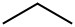
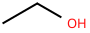
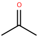
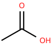
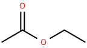
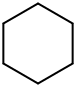
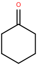
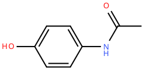
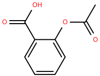
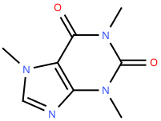

# Chem 13: One Molecule, Four Representations
**By: Ethan Seth S. Gratuito**

---

## 001. Propane
* **Chemical Formula:** C3H8
* **Ketcher Structure:**

---

## 002. Ethanol
* **Chemical Formula:** C2H6O
* **Ketcher Structure:**

---

## 003. Acetone
* **Chemical Formula:** C3H6O
* **Ketcher Structure:**

---

## 004. Acetic acid
* **Chemical Formula:** C2H4O2
* **Ketcher Structure:**

---

## 005. Ethyl acetate
* **Chemical Formula:** C4H8O2
* **Ketcher Structure:**

---

## 006. Cyclohexane
* **Chemical Formula:** C6H12
* **Ketcher Structure:**

---

## 007. Cyclohexanone
* **Chemical Formula:** C6H10O
* **Ketcher Structure:**

---

## 008. Acetaminophen
* **Chemical Formula:** C8H9NO2
* **Ketcher Structure:**

---

## 009. Aspirin
* **Chemical Formula:** C9H8O4
* **Ketcher Structure:**

---

## 010. Caffeine
* **Chemical Formula:** C8H10N4O2
* **Ketcher Structure:**

---
